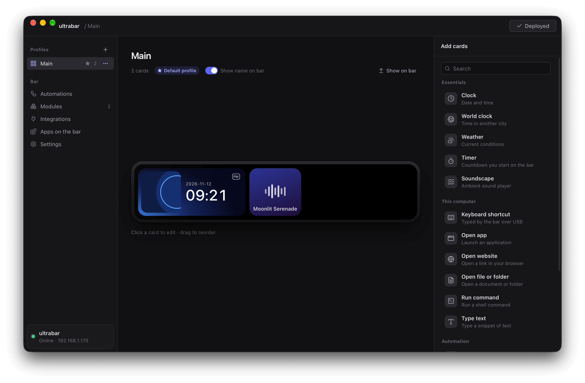

# ultrabar

A desktop app for [UltraBarX](https://www.kickstarter.com/projects/ultrabarx/ultrabar-x-future-desktop-revolution-aesthetics-function) with actually available source code, because the [official one](https://github.com/Qinkunex/UltraWorkspace) is closed source and I don't trust it after some antiviruses started reporting issues with one of their releases. It's probably vibe coded anyway - so I decided to vibe code my own!

Implemented by unleashing Opus 5.5 on the physical device, and also - because some genius left wireless ADB debugging enabled without any authentication - by reverse engineering APKs pulled from the device.

## Installation

Check [Releases](https://github.com/modrzew/ultrabar/releases) and download an installer for your Windows or macOS.
